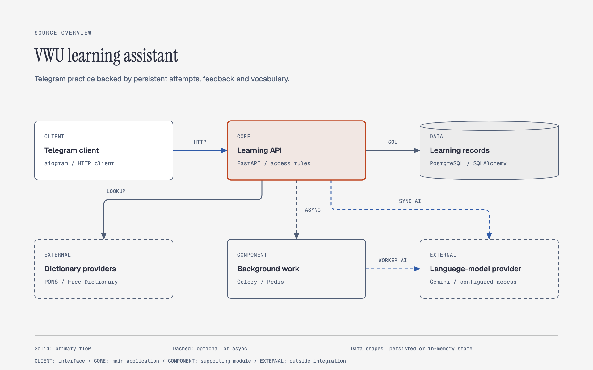

# VWU learning assistant

A Telegram study assistant for VWU exam preparation, with a backend for practice tasks, answer evaluation and vocabulary revision.

The bot presents the exercises and feedback. FastAPI keeps the academic rules and records, while PostgreSQL stores attempts, dictionary entries, flashcards and review history. The same repository contains the backend and Telegram client.

## What a learner can do

- Start a training session and submit answers for evaluation.
- Read feedback and follow progress across earlier attempts.
- Look up vocabulary and keep words for later practice.
- Revise flashcards through a scheduled review flow.

Staff can manage task catalogues and guidelines, inspect attempts and review score corrections through the administration surfaces.

## How it works



[Vector diagram](docs/diagrams/architecture.svg) · [Editable HTML](docs/diagrams/architecture.html)

The API supports synchronous processing and configurable background generation/evaluation through Celery and Redis. Gemini handles configured model work. Dictionary adapters use PONS and Free Dictionary, with cached entries in the application.

Telegram allowlists and the optional bot service token control access. Request context, audit records and idempotency support the attempt and review flows.

## Local setup

Use Docker Compose for PostgreSQL, Redis, API, worker and bot:

```bash
cp .env.example .env
docker compose up --build
```

Before starting the bot, set `BOT_TOKEN`, `ALLOWLIST_TELEGRAM_IDS` and the model/provider settings you intend to use. Set matching `BOT_SERVICE_TOKEN` values if service-token enforcement is enabled. Replace development administration credentials for a shared deployment.

| Entry point | Purpose |
| --- | --- |
| `http://localhost:8000/docs` | API reference |
| `/health/live` and `/health/ready` | Process and database health |
| `/admin` | Administration panel |
| `/panel` | Review and calibration dashboard |

## Stack

Python 3.12+ · FastAPI · aiogram · SQLAlchemy · PostgreSQL · Alembic · Redis · Celery · Gemini

## Code map

| Path | Responsibility |
| --- | --- |
| `bot/` | Telegram handlers, HTTP client and message rendering |
| `app/api/` | Learner, staff and health endpoints |
| `app/modules/` | Training, evaluation, dictionary, flashcards and statistics |
| `app/workers/` | Background-task runtime |
| `alembic/` | Database migrations |
| `tests/` | API, domain, worker and rendering checks |

For local development, install `.[dev]` from `pyproject.toml` and run `pytest`. The [MIT license](LICENSE) applies to the repository's code.
